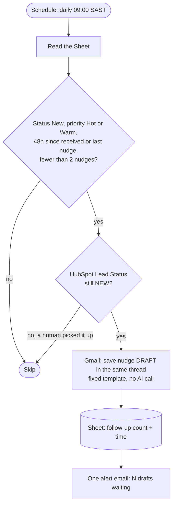
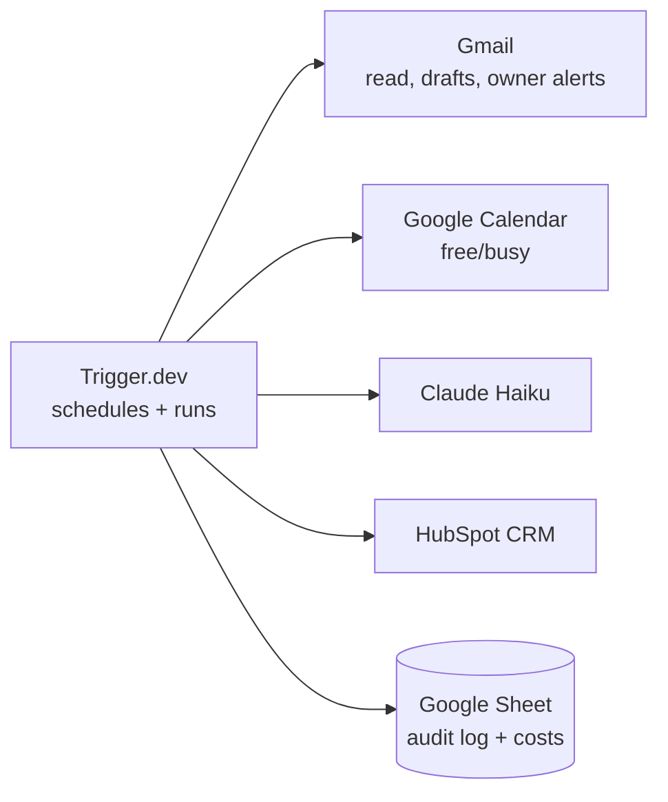

# Workflow diagrams

## Lead intake (`poll-leads`, every 10 minutes)

```mermaid
flowchart TD
    S([Schedule: every 10 min]) --> L[Gmail: list recent inbox mail<br/>not from the inbox itself]
    L --> K{Already in the Sheet<br/>by message ID?}
    K -- all known --> X([Stop: no AI call])
    K -- new mail --> CAP[Keep at most 10 per run]
    CAP --> CAL[Calendar free/busy:<br/>pick up to 3 weekday slots]
    CAL --> AI[Claude Haiku per email:<br/>is it a lead, intent, budget, area,<br/>timeline, priority, escalate, draft reply]
    AI --> Q{Real lead?}
    Q -- no --> IG[(Sheet row: Ignored)]
    Q -- yes --> HS[HubSpot: upsert contact, add note]
    HS --> T{Viewing asked<br/>or escalated?}
    T -- yes --> TK[HubSpot task:<br/>confirm viewing / call back today]
    T -- no --> DR
    TK --> DR[Gmail: save reply as DRAFT]
    DR --> AL{Escalated, Hot or Warm?}
    AL -- yes --> OA[Email alert to the owner only]
    AL -- no --> SR
    OA --> SR[(Sheet row, coloured by priority)]
    AI -. any step fails .-> ER[(Sheet row: Error)<br/>+ alert to owner]
    SR --> RUN[(Runs tab: tokens, cost, errors)]
```

Rules held in code, not by the model: the 10-email cap, who gets alerted, the owner-only send guard, deduping by message ID, and the escalation floor (an escalated lead is never Cold).

## Follow-up sweep (`follow-up-leads`, daily 09:00)



## Systems


